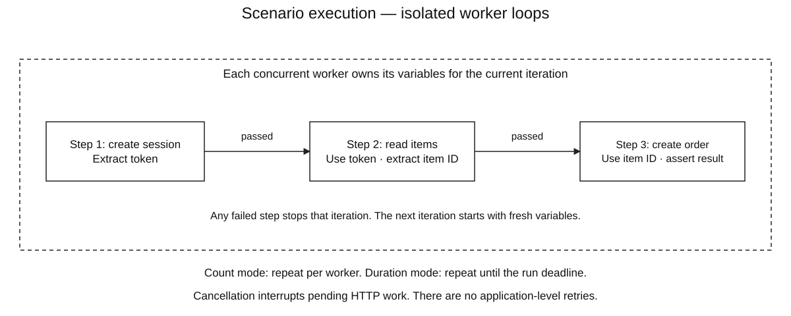
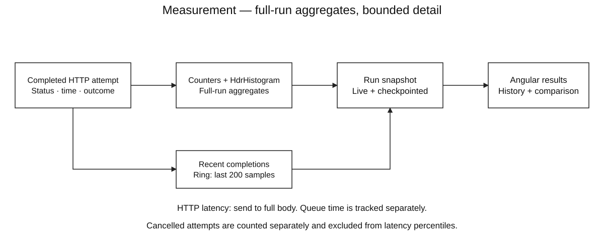
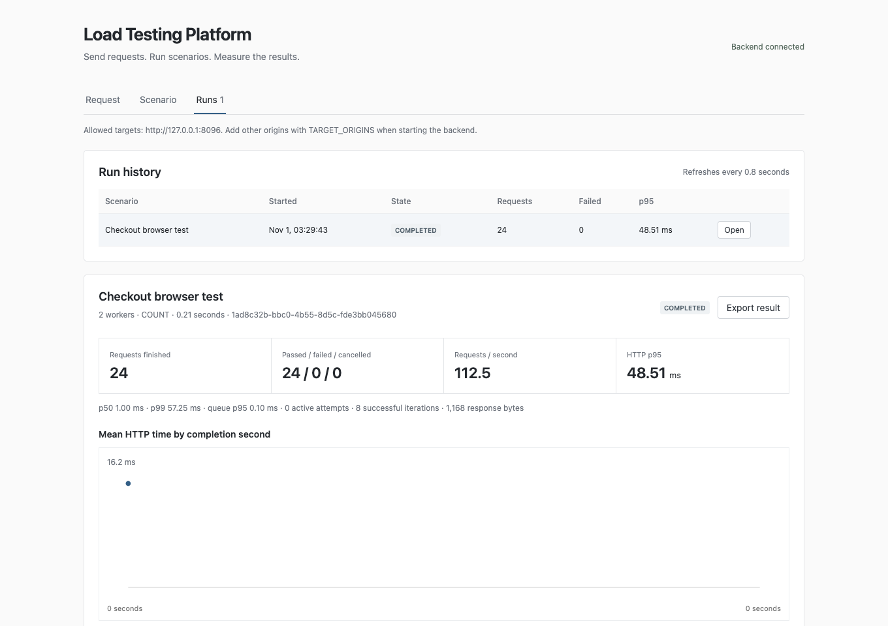

# Load Testing Platform

An **Angular + Java API testing application** for sending HTTP requests, chaining scenarios and running concurrent load tests. Build a workflow, extract values from responses, assert the next step, then inspect live latency, failures and saved run history.

**Java virtual threads · bounded concurrency · per-worker variables · full-body deadlines · HdrHistogram percentiles · persistent checkpoints · Angular workspace**

The Java execution engine generates real HTTP traffic. Angular provides the editor, live results and comparisons. The packaged application serves both from one local address; a separate built-in demo API makes the entire workflow reproducible without external accounts.

## Architecture


Spring Boot owns validation, admission, execution and persistence. Each run uses a fixed number of workers; each worker sends one request at a time and executes scenario steps in order. The frontend polls live results every 0.8 seconds. H2 provides file-backed local storage by default; the same JDBC repository supports PostgreSQL.

### Scenario execution



Every iteration starts with its own copy of the initial variables. A successful response can extract values using JSON Pointer, such as `/token`, for use in later `${token}` templates. A failed assertion, extraction or request ends that iteration. Other workers continue independently. Count mode limits iterations per worker; duration mode stops at a monotonic deadline.

### Measurement and retained detail



Counters and histograms cover the entire run. A bounded ring retains the last 200 completion samples; one-second buckets support the chart. Cancellation has a separate count and does not contribute latency observations. Live state is checkpointed about once per second and on completion.

### From scenario to report

1. Define HTTP steps, initial variables, expected status, assertions and response extractions.
2. Validate the workload and admit at most two active runs.
3. Start the configured number of virtual-thread workers. Limit outbound in-flight requests globally to 128.
4. Render each step's templates, check its allowed target origin, send HTTP and enforce a deadline over the entire response body.
5. Record the outcome, latency, queue time and complete response bytes. Continue only successful scenario steps.
6. Inspect the live result, compare a previous run, or export the report as JSON. Saved scenarios can also be imported/exported.

See [architecture and invariants](docs/ARCHITECTURE.md), [measurement definitions](docs/MEASUREMENTS.md) and [editable draw.io diagrams](docs/DIAGRAMS.md).

## Build

Requirements: **JDK 21+**, **Node.js compatible with Angular 21** (Node 22.12+ in the 22 line or Node 24), npm, `make`, curl and tar. Development checks were executed on macOS Apple Silicon with JDK 24.0.2 and Node 25.2.1. Prefer an LTS Node release for your installation. Python 3 is optional for the process-recovery verification script.

From the repository directory:

```sh
make setup
make build
make run
```

Open **<http://127.0.0.1:8085>**. The demo target listens on **127.0.0.1:8086**. Ctrl+C stops the app and its demo service. `make setup` installs locked frontend dependencies and downloads a checksum-verified Maven 3.9.11 into ignored `.tools/`; a global Maven install is unnecessary.

Angular is bundled into the executable JAR. Subsequent starts only need `make run` and Java; Node is needed again when rebuilding the frontend. The default H2 database lives under `data/` relative to the launch directory. Always launch from the project root to reuse the same local workspace.

On Windows, use WSL2/Ubuntu, install JDK 21+, a compatible Node release and build tools, then run these commands inside Ubuntu. Linux/WSL builds have not been executed on this development Mac. See [How to run](docs/HOW_TO_RUN.md) for setup, development servers, PostgreSQL and custom targets.

## Try the complete workflow

1. Open **Request** and click **Send request**. The default demo health endpoint returns actual HTTP status, headers and body.
2. Open **Scenario**. The included **Demo checkout** contains three steps: create session → read items → create order. The token and item ID come from earlier responses.
3. Save the scenario. Set two workers and four iterations per worker, then **Start run**.
4. A successful run finishes with **24 passed requests and 8 successful iterations**. View per-step results, recent completions and the latency chart.
5. Run again, select a previous run as the baseline, and compare p95 and throughput. Export the result or scenario as JSON.
6. To exercise failure handling, change the first expected status to 418; later steps in that iteration will not run. A duration run can be cancelled while requests are pending.



The screenshot comes from the real browser integration test. The demo's order endpoint returns a response but does not create external orders or contact a third-party service.

## Use your own API

Allow exact target origins when starting the backend. Paths may vary; schemes, hosts and ports must match an allowed origin. Redirects are returned without being followed.

```sh
TARGET_ORIGINS='http://127.0.0.1:8086,http://127.0.0.1:8000' make run
```

Then enter your API URL in Request or update the scenario's `baseUrl` variable. Include the demo origin if you still want the demo workflow. Changing the allowlist requires a restart. Only test services you own or are authorized to exercise.

Templates perform literal substitution in URLs, headers, bodies and assertion expectations; they do not automatically URL-encode or JSON-escape values. Missing variables fail that attempt explicitly. Supported assertions:

| Type | Path field | Expected value |
|---|---|---|
| `JSON_EQUALS` | JSON Pointer, e.g. `/items/0/name` | Scalar text or compact JSON for an object/array |
| `BODY_CONTAINS` | Unused | Literal substring |
| `HEADER_EQUALS` | Header name | Exact first-header value |

Expected status `0` accepts any HTTP status. Extraction maps variable names to JSON Pointers. Extracted values are available only to later steps in that iteration. The app performs no application-level retries, so a failed test step is visible rather than hidden by a retry policy.

## Algorithms and resource bounds

| Component | Structure / mechanism | Behavior |
|---|---|---|
| Concurrent execution | Virtual-thread workers + fair semaphore | Fixed worker count; at most 128 outbound request slots |
| Scenario variables | Per-iteration hash map | Expected O(1) lookup; no shared token map between workers |
| Latency distribution | HdrHistogram, three significant digits | Bounded histogram storage; percentiles from individual completed attempts |
| Recent samples | `ArrayDeque` ring | O(1) append/removal; last 200 completions |
| Timeline | Ordered second buckets | At most 121 elapsed-second buckets, including the boundary bucket |
| Live runs | Concurrent ID map | At most two admitted runs; no unbounded pending-run queue |
| Persistence | JDBC rows containing immutable JSON snapshots | Scenarios and reports survive restart; active work is not replayed |

Limits: 64 workers/run, 20 ordered steps, 500 count iterations/worker, 100,000 planned requests/count run, 120 seconds/run, 100–10,000 ms/request, 64 KiB expanded request body, 16 KiB expanded request headers and 1 MiB accepted response body. Eight interactive sends can be active; they share the global HTTP slots with load workers. Each scenario has at most 40 distinct variable names. The repository retains up to 100 saved scenarios and 200 terminal run reports; history lists the newest 100 runs.

These limits bound application work, not total process memory or kernel buffers. Virtual threads help concurrent waiting; they do not make CPU work faster. The result path, assertions, histogram locks, demo target, persistence and UI polling all consume resources on the same host.

## Reliability and measurement rules

- The deadline covers full response transfer, including a server that sends headers and then stalls its body. Response subscriptions are cancelled when the 1 MiB limit is exceeded.
- Cancelling a run interrupts pending HTTP operations. The run becomes terminal after its workers exit; active-attempt accounting returns to zero.
- `attempted = passed + failed + cancelled` for completed attempt records. A `COMPLETED` run means execution finished; inspect its failed count for test failures.
- HTTP latency measures send-to-full-body time. Preparation/slot queue time is separate; assertions and persistence are outside HTTP latency but affect run throughput.
- This is **closed-loop concurrency**, not a fixed request arrival rate. It does not correct coordinated omission or establish production capacity. See [measurement semantics](docs/MEASUREMENTS.md) before quoting results.
- On restart, checkpointed `RUNNING`/`CANCELLING` reports become `INTERRUPTED`. Recent uncheckpointed completions and in-flight attempts may be absent. No exactly-once execution or crash-resume guarantee is claimed.
- The API binds to loopback, checks browser origins, and restricts outbound origins. This is a local application without multi-user authentication. Saved headers, request bodies and variables are plaintext workspace data; use disposable test credentials.

## Tests and observations

```sh
make test
make browser-test
python3 scripts/verify_system.py
```

Backend tests exercise real HTTP, chained extraction, worker isolation, assertion failures, deadlines, response limits, cancellation, admission, persistence and histogram arithmetic. Browser tests exercise request editing, saved scenarios, load runs, failure results, import/export, comparisons and a mobile-width layout. Browser tests use Google Chrome by default and an isolated in-memory database; see [test instructions](docs/TESTING.md) for Chromium setup.

The process-level verifier launches the packaged app on temporary ports, checks a controlled 40 ms target, sends SIGKILL during active work, then verifies restart recovery and retained scenarios. Recorded observations and boundaries are in the [validation report](docs/VALIDATION_REPORT.md). They are local checks, not a comparison against established load-testing products.

## Code style

Concrete types, descriptive names and explicit ownership. Classes separate validation, HTTP execution, statistics, run lifecycle and storage. Comments explain edge cases such as full-body deadlines and restart semantics. Java uses AOSP formatting; TypeScript/templates/styles use Prettier. Application strings and documentation are English; private study notes are ignored by Git.

## Repository map

```text
backend/src/main/java/dev/apirunner/
  Definitions.java      Validation and template expansion
  Requests.java         Real HTTP, body budget and assertions
  RunEngine.java        Admission, worker lifecycle and cancellation
  Statistics.java       Counters, histograms and bounded samples
  Store.java            JDBC persistence and restart recovery
  Api.java              Local application endpoints
  Demo.java             Separate local demonstration target
frontend/src/           Angular workspace, editors and results
frontend/tests/         Real browser workflows
scripts/mvnw            Pinned Maven bootstrap
scripts/verify_system.py Packaged-app and process recovery checks
docs/                   Run guide, design, measurements and diagrams
```
